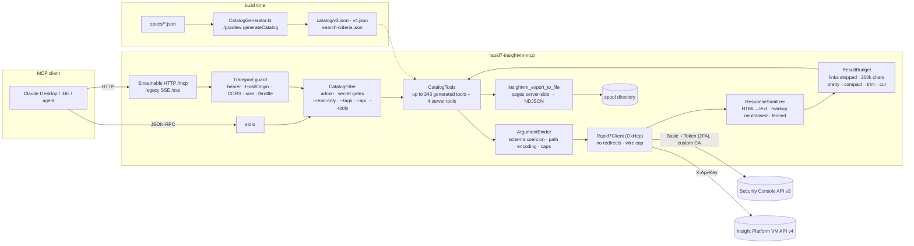

# Rapid7 InsightVM MCP Server

A [Model Context Protocol](https://modelcontextprotocol.io) server for Rapid7 InsightVM, written in Kotlin with the
[MCP Kotlin SDK](https://github.com/modelcontextprotocol/kotlin-sdk). It exposes the complete
**Security Console API v3** (330 operations) and **Insight Platform Cloud Integrations API v4** (13 operations) as MCP
tools, generated from the official OpenAPI specifications. Seven of them are registered only when the operator opts in:
console command execution, and six operations that return or set authentication secrets.

> Coverage is derived from Rapid7's published OpenAPI documents — *Rapid7 VM API 3* and *InsightVM Cloud Integrations
> API v4*. The documents themselves are not part of this repository; the generated catalog under
> `src/main/resources/catalog/` is.

## Requirements

* JDK 21+
* A Security Console account (API v3) and/or an [Insight Platform API key](https://insight.help.rapid7.com/docs/managing-platform-api-keys) (API v4)

## Configuration

Everything is configured through environment variables. Configure one or both API families.

| Variable | Required | Default | Description |
|---|---|---|---|
| `INSIGHTVM_CONSOLE_URL` | console | — | Console origin, e.g. `https://console.corp.example:3780` (no path; port defaults to 3780) |
| `INSIGHTVM_CONSOLE_USERNAME` | console | — | Console account (HTTP Basic) |
| `INSIGHTVM_CONSOLE_PASSWORD` | console | — | Console password |
| `INSIGHTVM_CONSOLE_2FA_TOKEN` | | — | The account's two-factor code, sent in the `Token` header. It is time-based: a fixed value stops working within about a minute, so prefer a service account without 2FA (startup prints a warning) |
| `INSIGHTVM_CONSOLE_CA_CERT` | | — | PEM file with the console's CA or self-signed certificate. A file holding one self-signed certificate pins it: a console presenting exactly that certificate is accepted at any host name or IP address, even one the certificate does not list. A CA or a bundle still requires the host to match |
| `INSIGHTVM_CONSOLE_INSECURE_TLS` | | `0` | `1` disables TLS verification for the console (lab use only; logged loudly) |
| `INSIGHTVM_API_KEY` | cloud | — | Insight Platform API key |
| `INSIGHTVM_REGION` | | `us` | `us`, `us2`, `us3`, `eu`, `ca`, `au`, `ap`, `aps2`, `me1` |
| `INSIGHTVM_CLOUD_BASE_URL` | | regional | Override the cloud base URL (must be `https`) |
| `INSIGHTVM_MCP_AUTH_TOKEN` | http | — | Bearer token for `--http`; **mandatory, and at least 32 characters, when binding a non-loopback address** (e.g. `openssl rand -hex 32`). A shorter one on loopback is warned about |
| `INSIGHTVM_HTTP_ALLOWED_ORIGINS` | | none | Comma-separated browser origins allowed in `--http` mode (`*` is ignored) |
| `INSIGHTVM_READ_ONLY` | | `0` | Register only read-only tools: every `GET`, plus the five query-only POST searches. The export tool is removed too |
| `INSIGHTVM_TAGS` / `INSIGHTVM_EXCLUDE_TAGS` | | all | Comma-separated API tags to include / hide |
| `INSIGHTVM_ALLOW_ADMIN_COMMANDS` | | `0` | Register `execute_command` (arbitrary console command execution) |
| `INSIGHTVM_ALLOW_SECRET_TOOLS` | | `0` | Register the six tools that return or set authentication secrets: a user's 2FA seed (read, regenerate, set) or password, and the scan-engine pairing secret (read, create). Off by default, `--read-only` included |
| `INSIGHTVM_ALLOW_HTTP` | | `0` | Permit cleartext `http://` API URLs (lab use only) |
| `INSIGHTVM_TIMEOUT_MS` | | `60000` | Per-request timeout |
| `INSIGHTVM_MAX_RESULT_CHARS` | | `200000` | Characters of API data one tool result may carry (~50k tokens). See [Large results](#large-results) |
| `INSIGHTVM_MAX_RESPONSE_BYTES` | | `16777216` | Memory guard on the wire, not a context budget — use the setting above for that |
| `INSIGHTVM_KEEP_RECORD_LINKS` | | `0` | `1` keeps the per-record HATEOAS `links` that are stripped by default |
| `INSIGHTVM_DEFAULT_PAGE_SIZE` | | `100` | `size` injected when a paged tool is called without one (clamped to 500) |
| `INSIGHTVM_SPOOL_DIR` | | `~/.rapid7-insightvm-mcp/spool` | Where `insightvm_export_to_file` writes. On POSIX an existing directory must be owned by the server's account and not group- or world-writable |
| `INSIGHTVM_SPOOL_RETENTION_HOURS` | | `24` | Exported files older than this are swept at startup; `0` never sweeps |
| `INSIGHTVM_DISABLE_EXPORT` | | `0` | `1` removes `insightvm_export_to_file`, the only tool that writes to disk |
| `INSIGHTVM_DISABLE_UPDATE_CHECK` / `INSIGHTVM_DISABLE_AUTO_UPDATE` | | `0` | Update behaviour (see below) |

On/off variables accept `1`/`true`/`yes`/`on` or `0`/`false`/`no`/`off`, in any case. Any other value stops the
server at startup, so a typo such as `INSIGHTVM_READ_ONLY=y` cannot leave a safety flag off. `INSIGHTVM_API_KEY`,
`INSIGHTVM_CONSOLE_2FA_TOKEN` and `INSIGHTVM_MCP_AUTH_TOKEN` are trimmed of surrounding whitespace. If what remains
contains a space or any character outside printable ASCII, the server does not start; the error names the variable
but never shows the value.

See [`.env.example`](.env.example) for a template.

## Build

```powershell
.\gradlew.bat clean check shadowJar
```

```bash
./gradlew clean check shadowJar
```

The runnable JAR is **`build/libs/rapid7-insightvm-mcp-0.2.1-all.jar`** (≈20 MB, all dependencies bundled). The
`-thin.jar` next to it contains only this project's classes and cannot be run (`no main manifest attribute`).
`check` runs the tests, enforces 90 % line coverage and verifies the catalog matches `specs/`.

## Run

```bash
# stdio (default) — for desktop clients
java -jar build/libs/rapid7-insightvm-mcp-0.2.1-all.jar --stdio

# Streamable HTTP (/mcp) + legacy SSE (/sse), default 127.0.0.1:3072
java -jar build/libs/rapid7-insightvm-mcp-0.2.1-all.jar --http --host 127.0.0.1 --port 3072
```

| Switch | Purpose |
|---|---|
| `--stdio` / `--http` | Transport (default `--stdio`) |
| `--host`, `--port` | HTTP bind address and port (default `127.0.0.1:3072`) |
| `--read-only` | Only read-only tools: every `GET`, plus the five query-only POST searches (`find_assets`, `sonar_query_search` and the three cloud searches) |
| `--tags Site,Asset` / `--exclude-tags User` | Filter by API tag (repeatable) |
| `--api console\|cloud\|both` | Which configured family to expose |
| `--tools 'get_site*'` | Glob on tool names (repeatable, case-insensitive) |
| `--allow-admin-commands` | Enable `execute_command` (off by default) |
| `--allow-secret-tools` | Enable the six tools that return or set authentication secrets (off by default, `--read-only` included) |
| `--no-update-check`, `--no-auto-update` | Update behaviour |

Command-line flags can only tighten what the environment allows; `--allow-admin-commands` and `--allow-secret-tools`
are the two explicit exceptions. If the filters leave no API tool at all, the server stops at startup and lists the
valid tags. A tag, excluded tag or glob that matches nothing is reported on stderr as a warning, and so is a glob
that names only secret tools while they are gated.

### Use with Claude Desktop

```json
{
  "mcpServers": {
    "insightvm": {
      "command": "java",
      "args": ["-jar", "C:\\tools\\rapid7-insightvm-mcp-0.2.1-all.jar", "--stdio"],
      "env": {
        "INSIGHTVM_CONSOLE_URL": "https://console.corp.example:3780",
        "INSIGHTVM_CONSOLE_USERNAME": "mcp-readonly",
        "INSIGHTVM_CONSOLE_PASSWORD": "…",
        "INSIGHTVM_CONSOLE_CA_CERT": "C:\\tools\\console-ca.pem",
        "INSIGHTVM_API_KEY": "…",
        "INSIGHTVM_REGION": "us"
      }
    }
  }
}
```

## Tools

Tool names are the spec's `operationId` in snake_case; cloud (v4) tools carry a `cloud_` prefix. Every tool is annotated
(`readOnlyHint`; on writes also `destructiveHint` and `idempotentHint`) and its description names the HTTP route
(`[v3 GET /api/3/assets]`). Only writes that purely add (`create_*`, `add_*`, `start_*`, `tag_*`, …) are marked
non-destructive; every other write also carries a `[destructive]` marker after its route (`execute_command` an
`[ADMIN: …]` one). `PUT` and `DELETE` tools are marked idempotent. The read-only tools are every `GET` plus five POST
searches that only query.

| API | Tag | Tools | Examples |
|---|---|---|---|
| Console v3 | Site | 84 | `get_sites`, `create_site`, `start_scan`, `get_site_scan_schedules` |
| Console v3 | User | 32 | `get_users`, `create_user`, `add_user_site` |
| Console v3 | Policy | 26 | `get_policies`, `get_policy_rule_rationale` |
| Console v3 | Asset | 25 | `get_assets`, `find_assets`, `get_asset_vulnerabilities` |
| Console v3 | Vulnerability | 24 | `get_vulnerabilities`, `get_vulnerability_solutions` |
| Console v3 | Asset Group / Scan Engine / Tag | 22 / 22 / 21 | `create_asset_group`, `get_scan_engines`, `get_tags` |
| Console v3 | Report | 13 | `get_reports`, `generate_report`, `download_report` |
| Console v3 | Asset Discovery, Policy Override, Administration, Vulnerability Result/Exception, Credential, Scan Template, Scan, Vulnerability Check, Root, Remediation | 61 | `get_sonar_queries`, `get_info`, `get_scans`, `get_asset_vulnerability_solutions` |
| Cloud v4 | Scan / Asset / Site / Vulnerability / Health | 13 | `cloud_search_integration_assets`, `cloud_start_scan`, `cloud_health` |

Four tools are the server's own rather than the API's: `insightvm_server_info` (version and update state, configuration, filters, counts),
`insightvm_list_tool_groups` (tools grouped by tag), `insightvm_search_criteria` and `insightvm_export_to_file` (see below).
`insightvm_search_criteria` serves the console's search-criteria reference: the fields a filter can name, the operators
each accepts and the value each operator takes. The Security Console documents this only in its specification's
introduction. The filter schemas of `find_assets`, asset groups, tags and dynamic sites point to the tool, and list
the valid `field` and `operator` values. It is registered whenever a console tool is.

## Large results

InsightVM returns a lot of data. One page of assets is a few hundred kilobytes; a widely-exploited vulnerability's
affected-asset list runs to megabytes. Measured on a 25,000-asset `get_affected_assets` response, and on the full
46,821-asset estate:

| | Cost |
|---|---|
| `get_affected_assets`, 25k assets, pretty-printed with links | 4.36 MB ≈ **1.2M tokens** |
| the same response, links stripped and compacted | 316 KB ≈ **88k tokens** |
| enumerating every asset by paging through the conversation | **~25M tokens** |
| the same data via `insightvm_export_to_file` | **~1k tokens** |
| a total count via `size=1` and `page.totalResources` | **~0.4k tokens** |

Four mechanisms follow from that, in the order they apply:

1. **Server-side filtering and counting come first.** For a count, call the tool with `size=1` and read
   `page.totalResources` (v3) or `metadata.totalResources` (v4). To narrow, use `find_assets` /
   `cloud_search_integration_assets`, which filter on the console rather than in the conversation.
2. **Per-record `links` are stripped.** The v3 API attaches a HATEOAS `links` array to every record; its entry is
   the record's own URL, derivable from its `id`. The top-level `links` (`rel=next`) and the `page`/`metadata`
   object are always kept, so paging and totals still work. Pass `include_links=true` on the call (every API tool
   accepts it, though only the paged ones list it), or set `INSIGHTVM_KEEP_RECORD_LINKS=1`, for the raw shape.
3. **Page size is defaulted and clamped** — 100 when omitted (the specification's own default of 10 makes a model
   page thousands of times), 500 maximum (above that a page cannot render inside the budget, so the console builds
   records that are then thrown away). Each paged tool's description and `size` schema (`default`, `maximum`) state
   the values in force, including an `INSIGHTVM_DEFAULT_PAGE_SIZE` override.
4. **Every result is budgeted** to `INSIGHTVM_MAX_RESULT_CHARS` through four rungs: pretty-print, compact,
   drop trailing records from the largest array while keeping the document valid JSON, and finally cut at a line
   boundary. Whatever happens, a server-authored notice is emitted **outside** the untrusted-data fence saying what
   was dropped and how to get it more cheaply.

### Reading a whole result set

Paging bulk data through a conversation cannot be made cheap — only avoided. `insightvm_export_to_file` drives any
read-only tool, follows every page on the server, writes NDJSON to a file and returns a short summary, so the token
cost is the same whether the result is 1 MB or 1 GB:

```jsonc
insightvm_export_to_file({
  "tool": "get_assets",              // any registered, non-mutating tool
  "arguments": { "sort": ["id,ASC"] } // what you would pass that tool; not page/size/cursor
})
```

It never takes a path: files are named by the server inside `INSIGHTVM_SPOOL_DIR`, created user-readable only, and
swept after `INSIGHTVM_SPOOL_RETENTION_HOURS`. A spool directory the server creates is private to its account (on
Windows, an access list naming only that account); one that already existed is never changed. Each run is bounded by
pages, records, bytes and wall-clock: a page that would overrun the time budget is abandoned rather than waited for,
and the byte cap is lowered so a run stops at the 256 MiB the volume keeps free. A run stopped by a cap returns a
resume token plus the partial file. Pages are written whole (so `max_records` stops at
the first page boundary at or after it), and the token names the first page not yet written, with the `page_size`
to resume at. Pages default to 500 records, the API's maximum. A page over `INSIGHTVM_MAX_RESPONSE_BYTES` is retried
at a smaller size by page-numbered tools; a cursor run stops and says which cap it hit. A `.manifest.json` sidecar
records the query and the outcome. Binary payloads (`get_logs`, `download_report`) spill to the same directory
instead of being inlined as base64. Set `INSIGHTVM_DISABLE_EXPORT=1` for a deployment that must never write to disk;
`--read-only` also removes the tool. When it is absent, no tool description or truncation notice recommends it.

### Working with a large tool set

By default the server lists 340 tools: 336 API tools (the seven gated ones stay off) and its own 4. That is more than
some clients handle comfortably, and above 128 the server says so on stderr. Recommended profiles:

```bash
--read-only                                   # 189 API tools + 3 server tools, nothing can change
--tags Site,Asset,Vulnerability,Scan          # day-to-day vulnerability management
--api cloud                                   # just the 13 Insight Platform tools
--tools 'get_*' --tools 'cloud_*'             # custom allow-list by glob
```

## Architecture



The server never parses the OpenAPI documents at runtime. `CatalogGenerator` (`./gradlew generateCatalog`) turns them into a compact, pre-dereferenced
catalog that is committed and verified by the build; one generic dispatcher registers every entry as a tool.

## Security

Summarised here; details and residual risks in [docs/SECURITY.md](docs/SECURITY.md).

* **Prompt injection** — every API body is wrapped in an explicit *untrusted data* fence with an instruction preamble;
  fence markers inside the data are neutralised. Tool descriptions come from the bundled spec with markup stripped or
  neutralised.
* **XSS / markup** — HTML responses are reduced to escaped text; `<`/`>` are neutralised in all JSON/text output so nothing
  from the API can render as markup in a client.
* **Request integrity** — URLs are built only from catalog templates; path values are percent-encoded (`;` included)
  and `.`/`..` are refused; unknown arguments are rejected; strings, bodies, arrays and nesting are bounded.
* **Credential egress** — redirects are never followed; no URL taken from an API response is ever requested; `https`
  is mandatory unless `INSIGHTVM_ALLOW_HTTP=1`; secrets never appear in logs or `toString`, and a key or token that
  could not be sent as a header stops the server at startup, before a library error could quote it to the model.
* **HTTP transport** — bearer token (required off-loopback, constant-time compare, brute-force throttle), `Host`/`Origin`
  checks against DNS rebinding, default-deny CORS, 4 MiB request cap (chunked bodies included). At most 32 sessions
  are kept: beyond that the oldest is closed, and its client gets `404` (or sees its SSE stream end) and initializes
  again.
* **Dangerous operations** — `execute_command` is unregistered unless `--allow-admin-commands` *and* then requires
  `confirm="EXECUTE"`; every mutation that is not purely additive is flagged `destructiveHint`, including list
  replacements, status changes and credential resets; `--read-only` removes every mutation.
* **Secrets** — the six tools that return or set an authentication secret (`get_two_factor_authentication_key` returns
  any user's TOTP seed, `get_current_shared_secret` the engine pairing secret) are unregistered unless
  `--allow-secret-tools`, even under `--read-only`, and the export tool refuses them even then.
* **TLS** — strict by default; trust a private CA, or pin the console's own self-signed certificate, with
  `INSIGHTVM_CONSOLE_CA_CERT`. A pinned certificate is accepted whatever host name or IP address the URL uses, so a
  console reached by IP does not need `INSECURE_TLS`, which is explicit and loud.
* **Result size** — two tiers: a wire-byte memory guard and a character budget for what reaches the model, with a
  degradation ladder that keeps trimmed JSON valid and always says what it dropped, outside the fence.
* **Spooled files** — `insightvm_export_to_file` is the only tool that writes to disk. It takes no path, names files
  itself inside a user-only directory, refuses state-changing and secret-returning operations, and cannot reach a tool
  the filters hid.

### Troubleshooting a start-up failure

The server prints a diagnostic banner to stderr before doing anything else — version, JVM, the JAR it was loaded
from, its arguments and which `INSIGHTVM_*` variables are set (names only). Desktop clients surface stderr in their MCP
log, so that is the first place to look:

| Symptom in the client log | Cause |
|---|---|
| `no main manifest attribute, in …jar` | The `-thin.jar` was deployed; use the `-all.jar` |
| `Configuration error: …` | Missing/invalid `INSIGHTVM_*` variable, or filters that select no tool — the message names it |
| `Refusing to listen on …` | `--http` on a non-loopback address without `INSIGHTVM_MCP_AUTH_TOKEN`, or with one shorter than 32 characters |
| console tools return HTTP 401 a minute or so after start | `INSIGHTVM_CONSOLE_2FA_TOKEN` is a time-based code; use an account without 2FA |
| banner printed, then nothing | Normal for stdio: the server is waiting for the client's `initialize` |

## Updates

On start the server checks GitHub for a newer release (set `INSIGHTVM_DISABLE_UPDATE_CHECK=1` in air-gapped environments)
and, unless `INSIGHTVM_DISABLE_AUTO_UPDATE=1` / `--no-auto-update`, downloads and verifies (SHA-256, size, entry point)
the new JAR and installs it:

* **Linux and macOS** — the JAR is replaced at once. The running server keeps the file it started from; the next start
  runs the new release.
* **Windows** — a running JAR cannot be replaced, so the update is staged beside it and written into it as the server
  exits. It is written only if no other server is still running from the same JAR (stdio clients each start their
  own) and the JAR is still the one the update was staged for; otherwise the staged copy is discarded and a later
  start fetches the update again.

Two empty files beside the JAR, `<jar>.update.lock` and `<jar>.running`, are the locks that coordinate this between
servers; they are left in place on purpose.

Clients are sent an MCP logging notification either way, but only on a best-effort basis: over HTTP it goes out two
seconds after the client initializes, and a client with no event stream open by then never receives it.
`insightvm_server_info` is the authoritative answer, whatever the transport: it reports the running version, the
latest release, and whether an update is available, downloaded and waiting for the server to exit, or installed.

## Development

```bash
./gradlew generateCatalog            # regenerate the catalog (needs the OpenAPI documents in specs/, see docs/CATALOG.md)
./gradlew test jacocoTestReport      # tests + coverage (build/reports/jacoco/test/html)
./gradlew run --args="--stdio"       # dev loop
```

See [docs/CATALOG.md](docs/CATALOG.md) for the generator's rules and [docs/CODE_COVERAGE.md](docs/CODE_COVERAGE.md) for the
coverage gate.

## License

[MIT](LICENSE)
