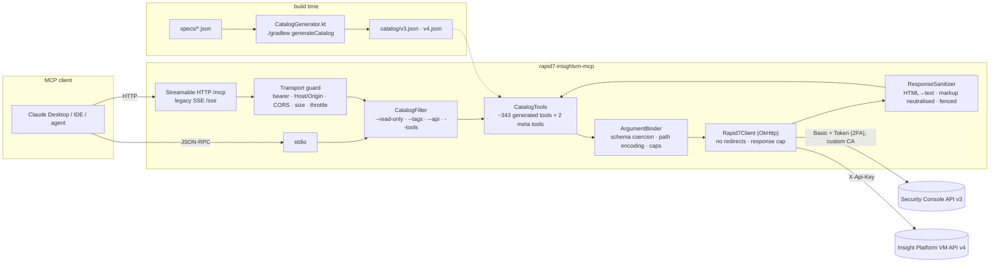

# Rapid7 InsightVM MCP Server

A [Model Context Protocol](https://modelcontextprotocol.io) server for Rapid7 InsightVM, written in Kotlin with the
[MCP Kotlin SDK](https://github.com/modelcontextprotocol/kotlin-sdk). It exposes the complete
**Security Console API v3** (330 operations) and **Insight Platform Cloud Integrations API v4** (13 operations) as MCP
tools, generated from the official OpenAPI specifications.

> Coverage is derived from the bundled specifications in [`specs/`](specs/): *Rapid7 VM API 3* and *InsightVM Cloud
> Integrations API v4*.

---

## Architecture



The server never parses the OpenAPI documents at runtime. `CatalogGenerator` (`./gradlew generateCatalog`) turns them into a compact, pre-dereferenced
catalog that is committed and verified by the build; one generic dispatcher registers every entry as a tool.

## Requirements

* JDK 21+
* A Security Console account (API v3) and/or an [Insight Platform API key](https://insight.help.rapid7.com/docs/managing-platform-api-keys) (API v4)

## Configuration

Everything is configured through environment variables. Configure one or both API families.

| Variable | Required | Default | Description |
|---|---|---|---|
| `INSIGHTVM_CONSOLE_URL` | console | — | Console origin, e.g. `https://console.corp.example:3780` (no path; port defaults to 3780) |
| `INSIGHTVM_CONSOLE_USERNAME` | console | — | Console account (HTTP Basic) |
| `INSIGHTVM_CONSOLE_PASSWORD` | console | — | Console password |
| `INSIGHTVM_CONSOLE_2FA_TOKEN` | | — | Two-factor token sent in the `Token` header |
| `INSIGHTVM_CONSOLE_CA_CERT` | | — | PEM file with the console's CA or self-signed certificate |
| `INSIGHTVM_CONSOLE_INSECURE_TLS` | | `0` | `1` disables TLS verification for the console (lab use only; logged loudly) |
| `INSIGHTVM_API_KEY` | cloud | — | Insight Platform API key |
| `INSIGHTVM_REGION` | | `us` | `us`, `us2`, `us3`, `eu`, `ca`, `au`, `ap`, `aps2`, `me1` |
| `INSIGHTVM_CLOUD_BASE_URL` | | regional | Override the cloud base URL (must be `https`) |
| `INSIGHTVM_MCP_AUTH_TOKEN` | http | — | Bearer token for `--http`; **mandatory when binding a non-loopback address** |
| `INSIGHTVM_HTTP_ALLOWED_ORIGINS` | | none | Comma-separated browser origins allowed in `--http` mode (`*` is ignored) |
| `INSIGHTVM_READ_ONLY` | | `0` | Register only `GET` tools |
| `INSIGHTVM_TAGS` / `INSIGHTVM_EXCLUDE_TAGS` | | all | Comma-separated API tags to include / hide |
| `INSIGHTVM_ALLOW_ADMIN_COMMANDS` | | `0` | Register `execute_command` (arbitrary console command execution) |
| `INSIGHTVM_ALLOW_HTTP` | | `0` | Permit cleartext `http://` API URLs (lab use only) |
| `INSIGHTVM_TIMEOUT_MS` | | `60000` | Per-request timeout |
| `INSIGHTVM_MAX_RESPONSE_BYTES` | | `5000000` | Response bodies beyond this are truncated |
| `INSIGHTVM_DISABLE_UPDATE_CHECK` / `INSIGHTVM_DISABLE_AUTO_UPDATE` | | `0` | Update behaviour (see below) |

See [`.env.example`](.env.example) for a template.

## Build

```powershell
.\gradlew.bat clean check shadowJar
```

```bash
./gradlew clean check shadowJar
```

The runnable JAR is **`build/libs/rapid7-insightvm-mcp-0.1.0-all.jar`** (≈20 MB, all dependencies bundled). The
`-thin.jar` next to it contains only this project's classes and cannot be run (`no main manifest attribute`).
`check` runs the tests, enforces 90 % line coverage and verifies the catalog matches `specs/`.

## Run

```bash
# stdio (default) — for desktop clients
java -jar build/libs/rapid7-insightvm-mcp-0.1.0-all.jar --stdio

# Streamable HTTP (/mcp) + legacy SSE (/sse), default 127.0.0.1:3072
java -jar build/libs/rapid7-insightvm-mcp-0.1.0-all.jar --http --host 127.0.0.1 --port 3072
```

| Switch | Purpose |
|---|---|
| `--stdio` / `--http` | Transport (default `--stdio`) |
| `--host`, `--port` | HTTP bind address and port (default `127.0.0.1:3072`) |
| `--read-only` | Only `GET` tools |
| `--tags Site,Asset` / `--exclude-tags User` | Filter by API tag (repeatable) |
| `--api console\|cloud\|both` | Which configured family to expose |
| `--tools 'get_site*'` | Glob on tool names (repeatable) |
| `--allow-admin-commands` | Enable `execute_command` (off by default) |
| `--no-update-check`, `--no-auto-update` | Update behaviour |

Command-line flags can only tighten what the environment allows; `--allow-admin-commands` is the single explicit exception.

### Use with Claude Desktop

```json
{
  "mcpServers": {
    "insightvm": {
      "command": "java",
      "args": ["-jar", "C:\\tools\\rapid7-insightvm-mcp-0.1.0-all.jar", "--stdio"],
      "env": {
        "INSIGHTVM_CONSOLE_URL": "https://console.corp.example:3780",
        "INSIGHTVM_CONSOLE_USERNAME": "mcp-readonly",
        "INSIGHTVM_CONSOLE_PASSWORD": "…",
        "INSIGHTVM_CONSOLE_CA_CERT": "C:\\tools\\console-ca.pem",
        "INSIGHTVM_API_KEY": "…",
        "INSIGHTVM_REGION": "us"
      }
    }
  }
}
```

## Tools

Tool names are the spec's `operationId` in snake_case; cloud (v4) tools carry a `cloud_` prefix. Every tool is annotated
(`readOnlyHint`, `destructiveHint`) and its description names the HTTP route.

| API | Tag | Tools | Examples |
|---|---|---|---|
| Console v3 | Site | 84 | `get_sites`, `create_site`, `start_scan`, `get_site_scan_schedules` |
| Console v3 | User | 32 | `get_users`, `create_user`, `add_user_site` |
| Console v3 | Policy | 26 | `get_policies`, `get_policy_rule_rationale` |
| Console v3 | Asset | 25 | `get_assets`, `find_assets`, `get_asset_vulnerabilities` |
| Console v3 | Vulnerability | 24 | `get_vulnerabilities`, `get_vulnerability_solutions` |
| Console v3 | Asset Group / Scan Engine / Tag | 22 / 22 / 21 | `create_asset_group`, `get_scan_engines`, `get_tags` |
| Console v3 | Report | 13 | `get_reports`, `generate_report`, `download_report` |
| Console v3 | Asset Discovery, Policy Override, Administration, Vulnerability Result/Exception, Credential, Scan Template, Scan, Vulnerability Check, Root, Remediation | 61 | `get_sonar_queries`, `get_info`, `get_scans`, `get_asset_vulnerability_solutions` |
| Cloud v4 | Scan / Asset / Site / Vulnerability / Health | 13 | `cloud_search_integration_assets`, `cloud_start_scan`, `cloud_health` |

Two meta tools help navigate the set: `insightvm_server_info` (configuration, filters, counts) and
`insightvm_list_tool_groups` (tools grouped by tag).

### Working with a large tool set

343 tools is more than some clients handle comfortably. Recommended profiles:

```bash
--read-only                                   # 186 tools, nothing can change
--tags Site,Asset,Vulnerability,Scan          # day-to-day vulnerability management
--api cloud                                   # just the 13 Insight Platform tools
--tools 'get_*' --tools 'cloud_*'             # custom allow-list by glob
```

## Security

Summarised here; details and residual risks in [docs/SECURITY.md](docs/SECURITY.md).

* **Prompt injection** — every API body is wrapped in an explicit *untrusted data* fence with an instruction preamble;
  fence markers inside the data are neutralised. Tool descriptions come from the bundled spec with markup stripped.
* **XSS / markup** — HTML responses are reduced to escaped text; `<`/`>` are neutralised in all JSON/text output so nothing
  from the API can render as markup in a client.
* **Request integrity** — URLs are built only from catalog templates; path values are percent-encoded and `.`/`..` are
  refused; unknown arguments are rejected; strings, bodies, arrays and nesting are bounded.
* **Credential egress** — redirects are never followed; HATEOAS links are only followed to the configured origin; `https`
  is mandatory unless `INSIGHTVM_ALLOW_HTTP=1`; secrets never appear in logs or `toString`.
* **HTTP transport** — bearer token (required off-loopback, constant-time compare, brute-force throttle), `Host`/`Origin`
  checks against DNS rebinding, default-deny CORS, 4 MiB request cap.
* **Dangerous operations** — `execute_command` is unregistered unless `--allow-admin-commands` *and* then requires
  `confirm="EXECUTE"`; all mutations are flagged `destructiveHint` where applicable; `--read-only` removes them entirely.
* **TLS** — strict by default; trust a private CA with `INSIGHTVM_CONSOLE_CA_CERT`; `INSECURE_TLS` is explicit and loud.

### Troubleshooting a start-up failure

The server prints a diagnostic banner to stderr before doing anything else — version, JVM, the JAR it was loaded
from, its arguments and which `INSIGHTVM_*` variables are set (names only). Desktop clients surface stderr in their MCP
log, so that is the first place to look:

| Symptom in the client log | Cause |
|---|---|
| `no main manifest attribute, in …jar` | The `-thin.jar` was deployed; use the `-all.jar` |
| `Configuration error: …` | Missing/invalid `INSIGHTVM_*` variable — the message names it |
| `Refusing to listen on …` | `--http` on a non-loopback address without `INSIGHTVM_MCP_AUTH_TOKEN` |
| banner printed, then nothing | Normal for stdio: the server is waiting for the client's `initialize` |

## Updates

On start the server checks GitHub for a newer release (set `INSIGHTVM_DISABLE_UPDATE_CHECK=1` in air-gapped environments)
and, unless `INSIGHTVM_DISABLE_AUTO_UPDATE=1` / `--no-auto-update`, downloads and verifies (SHA-256, size, entry point)
the new JAR and swaps it in at shutdown. Clients receive an MCP logging notification either way.

## Development

```bash
./gradlew generateCatalog            # regenerate the catalog after updating specs/
./gradlew test jacocoTestReport      # tests + coverage (build/reports/jacoco/test/html)
./gradlew run --args="--stdio"       # dev loop
```

See [docs/CATALOG.md](docs/CATALOG.md) for the generator's rules and [docs/CODE_COVERAGE.md](docs/CODE_COVERAGE.md) for the
coverage gate.

## License

[MIT](LICENSE)
